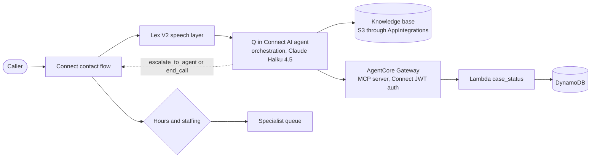

# Benefits help line on Amazon Q in Connect

A contact center line for a fictional federal benefits office, answered by an Amazon Q in Connect AI agent and built from nothing with one `terraform apply`.

Callers can ask about benefit programs, check the status of their case, or ask for a person. The agent answers program questions from a knowledge base, looks up cases through an MCP tool, and hands the caller back to the contact flow when they need a specialist or are done.

## How it works



The contact flow starts a Q in Connect session, points it at this line's agent, and hands every turn to a Lex bot whose only real intent is `AMAZON.QInConnectIntent`. The orchestration agent decides what to do on each turn. It has four tools:

| Tool | Type | What it does |
|---|---|---|
| `Retrieve` | Q in Connect native | Searches the program and policy articles |
| `get_case_status` | MCP, through AgentCore Gateway | Looks up a case once the caller gives a case number and ZIP code |
| `escalate_to_agent` | Return to control | Ends the AI turn so the flow can route to a specialist |
| `end_call` | Return to control | Ends the AI turn so the flow can hang up |

The agent never routes calls itself. When it returns control, the flow reads which tool fired and does the routing, including the hours and staffing checks before a transfer. That keeps telephony decisions in the flow, where they're visible and testable.

## Design notes

Verification. A case is only shared after the case number and ZIP code match the same record. A wrong ZIP and an unknown case get the same answer, so a caller can't probe for valid case numbers, and the ZIP is compared in constant time and never echoed back. The prompt tells the agent to read the case number back before looking it up and never to ask for a Social Security number.

Least privilege. The tool Lambda can call `GetItem` on one table. The gateway role can invoke that one function. The Lex role is scoped to this assistant and its sessions. The AI agent can only call tools granted to it in a Connect security profile.

Encryption and logs. One customer managed KMS key with rotation covers the table, the Lambda environment, every log group, both S3 buckets and the alarm topic. The tool logs a masked case number and an outcome, never the ZIP code. Lex conversation logs hold what callers say, so they're off unless `enable_conversation_logs` is set.

Guardrail. The agent runs behind a Q in Connect AI guardrail with content filters, prompt attack detection, denied topics for legal advice and politics, and PII masking for Social Security, bank account and card numbers.

Abuse limits. A demo number can be dialed by anyone, so the flow's first step asks a gate Lambda whether today's contact count is under `daily_contact_limit` (20 by default). Anything but an explicit yes, including a Lambda error, plays a closing message and hangs up before any AI session starts. A sweep runs every minute and ends any contact older than `max_contact_minutes` (8). Together they put a hard ceiling on what the line can spend in a day.

Versioning. The agent pins published versions of its prompt and guardrail. Changing either file cuts a new version and moves the agent to it on the next apply.

Partitions. Every ARN is built from `aws_partition`, so nothing assumes the commercial partition. Check that Connect, Q in Connect and AgentCore Gateway are available in your target region before deploying there.

## Where Terraform needed help

Some of this is new enough that the providers haven't caught up. These are the workarounds, so nobody has to rediscover them.

The Lex intent that hands turns to Q in Connect needs the assistant ARN, and neither the `aws` nor the `awscc` provider can set it. Lex's import format can, so Terraform renders the bot definition, zips it and imports it from S3 (`lex.tf`).

Attaching the security profile to the AI agent, and making the agent the self-service default on an assistant this project creates, have no Terraform resources yet. Two small `terraform_data` resources call the AWS CLI for those, and both undo themselves on destroy (`agent.tf`).

Connect puts the MCP integration identifier in the JWT audience it sends to the gateway. The identifier can be any string, so it's set to a known name and used as the gateway's allowed audience. That avoids a second pass to feed the gateway ID back into its own config.

The CloudFormation handler for AI guardrails fails with a bare `GeneralServiceException` unless the PII entity list and the regex list are both present. An agent also can't reference a guardrail without a version qualifier, and the API returns topic examples sorted, so they're sorted in config to avoid a permanent diff.

## Deploy

You need Terraform 1.9 or later, AWS CLI v2 and admin credentials for a sandbox account in a region with Connect, Q in Connect and AgentCore Gateway. It was built and tested in us-east-1. The account needs room for one more Connect instance.

```sh
cp terraform.tfvars.example terraform.tfvars   # set aws_profile and anything else
terraform init
terraform apply
```

The apply takes a few minutes. After that, the knowledge base needs about 15 minutes to ingest and index the articles. Until it's done, the agent says it doesn't have the answer and offers a specialist.

### Into an existing instance

Most teams already have a Connect instance, and an instance can hold only one Q in Connect assistant. Set `existing_instance_id`, and `existing_assistant_id` if the instance already has an assistant. The stack then adds its own prompt, guardrail, agent and knowledge base to that assistant without touching the assistant's default agent. A small Lambda (`bind_agent`) points each session at this agent right after the flow creates it, so other lines on the same assistant keep answering as before. The live demo runs this way.

The aws provider treats `instance_id` on queues, hours and flows as updatable in place, so moving an existing deployment from one instance to another needs `-replace` on those three.

### Phone number

Set `claim_phone_number = true` to give the line a number. In some accounts a new instance can't claim one and fails with "The allowed limit for claimed phone numbers has been exceeded for your instance", even though the documented default is 10. Service Quotas shows the real value as "Phone numbers per instance" at the resource level. Request an increase there with the instance ARN as the context, and AWS Support reviews it.

## Test

Unit tests cover the case tool and the call guard against mocked DynamoDB:

```sh
python -m venv .venv && . .venv/bin/activate
pip install -r requirements-dev.txt
pytest
```

`scripts/chat_smoke.py` talks to the deployed line over a real Connect chat contact, through the same flow, Lex bot and agent a call uses. MCP tools only run on a real contact, because the gateway's token is minted from the contact's identity, so this is the cheapest way to prove the whole tool path.

```sh
python scripts/chat_smoke.py                          # built-in scenario
python scripts/chat_smoke.py "What's the status of case 10483726?" "22201"
```

The sample cases are in `data/sample-cases.json`.

CI runs ruff, pytest, `terraform fmt`, `terraform validate` and checkov on every push. Checkov passes with 22 skips, and each skip has its reason written next to it in the code.

## A real conversation

From `scripts/chat_smoke.py` against the deployed stack:

```text
LINE:   Thanks for calling the benefits help line. I can check on a case or answer
        questions about our programs. How can I help?
CALLER: Hi, I want to check on my case.
LINE:   I'd be happy to help you check on your case. I'll need your 8 digit case
        number to get started.
CALLER: My case number is 20591847.
LINE:   Got it, let me read that back: 2 0 5 9 1 8 4 7. Is that correct?
CALLER: Yes, that's right.
LINE:   Great. Now I need the 5 digit ZIP code from your application.
CALLER: The ZIP code is 20002.
LINE:   Perfect, let me look that up for you.
LINE:   Your retirement benefits application is missing a copy of your marriage
        certificate. You need to upload it at benefits.example by November
        thirtieth, or mail it to the address on the request letter. Is there
        anything else I can help with?
CALLER: How long do I have to appeal a decision if I disagree with it?
LINE:   You have 60 days from the date on the decision letter to file an appeal.
        You can file at benefits.example or with a specialist.
CALLER: Can I talk to a person?
LINE:   I'm connecting you with a benefits specialist now.
LINE:   No specialists are available right now. Please call back later, and thank
        you for your patience.
(the line ended the contact)
```

The last two lines come from the flow, not the agent: it returned control with `escalate_to_agent`, the flow checked hours and staffing, and nobody was signed in.

Other runs confirmed that a wrong ZIP gets "no match" without saying which number was off, that a goodbye triggers `end_call` and the flow hangs up, and that the guardrail refuses prompt injection, questions about the model and political questions.

## Cost

A Connect instance has no fixed fee. Connect bills per minute or per message, a claimed number is about a dollar a month, and the KMS key is a dollar a month. Lambda, DynamoDB, S3 and the gateway cost pennies at test volume. With the default limits, the most the line can run is 20 contacts of 8 minutes a day. Run `terraform destroy` when you're done.

## Layout

```text
main.tf             providers, shared locals
connect.tf          instance, hours, queue, flow, number, integrations
agent.tf            assistant, prompt, guardrail, AI agent, security profile
knowledge.tf        S3 knowledge base and its ingestion
lex.tf              speech layer bot, built from Lex's import format
tools.tf            case table, tool Lambda, AgentCore Gateway and target
guard.tf            daily contact limit and long-contact sweep
monitoring.tf       alarms on the tool Lambda
kms.tf              the customer managed key
flows/              contact flow template
prompts/            orchestration prompt
knowledge/          program and policy articles
lambda/             MCP tool and call guard code
tests/              unit tests
scripts/            live smoke test
data/               sample cases
```

The agency, its programs, its cases and benefits.example are all made up.
